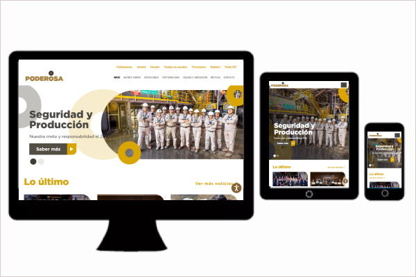
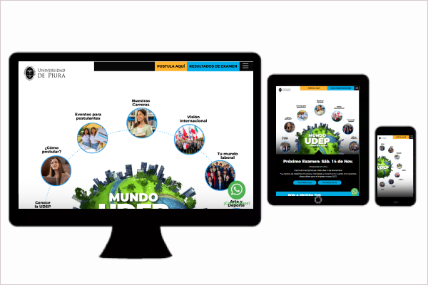
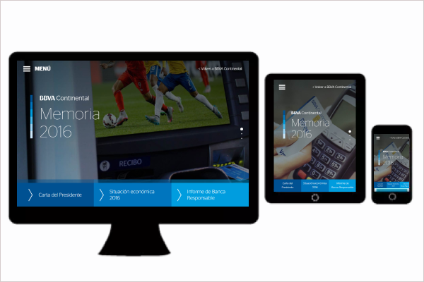
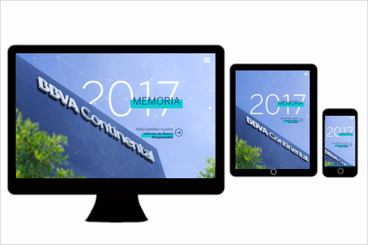
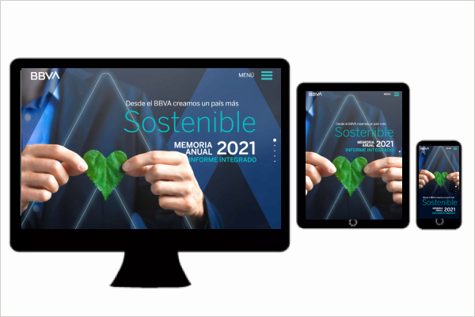
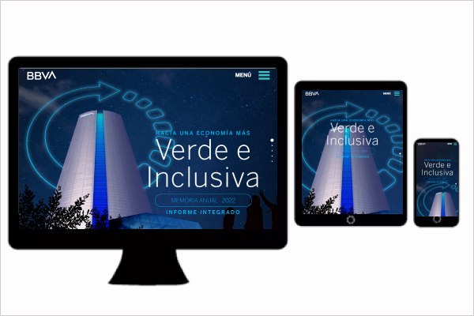
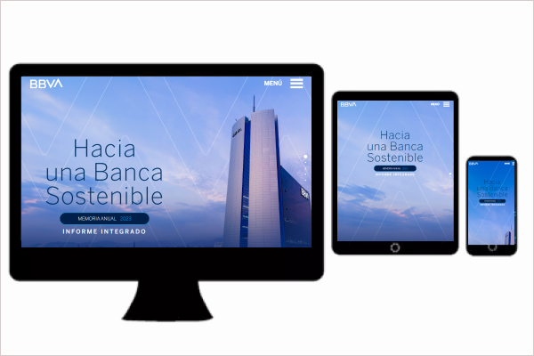
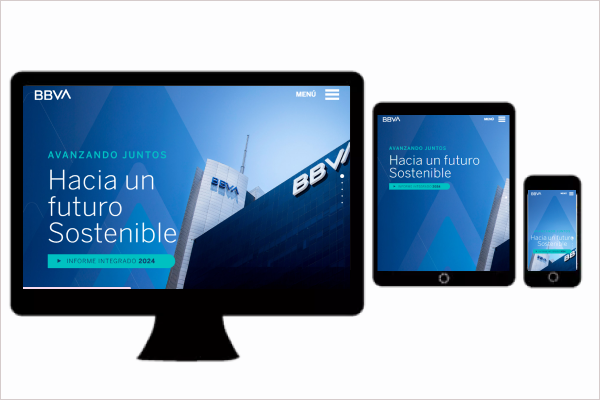
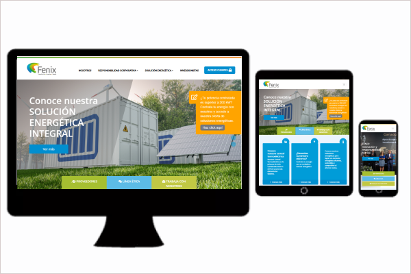
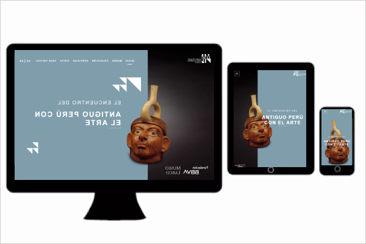

# Portafolio de Frontend Developer | Desarrollo Web

¡Hola! Soy Frontend Developer orientada a construir interfaces web atractivas, responsivas y eficientes. Me apasiona transformar diseños en experiencias digitales fluidas, combinando código limpio y las mejores prácticas.

En este portafolio encontrarás algunos de los proyectos y aplicaciones donde he implementado soluciones frontend adaptadas a diversos dispositivos.

## Tecnologías

- PHP
- ASP.NET MVC
- HTML5
- CSS3
- JavaScript
- WordPress
- SQL Server
- MySQL
- Páginas en Responsive Design
- Bootstrap
- Jquery

## Proyectos

### Sitio web corporativo – Minera Poderosa

**Descripción:**
Desarrollo de un sitio web corporativo responsive para Minera Poderosa, orientado a comunicar información institucional, noticias, proyectos y contenido empresarial, facilitando el acceso a la información desde distintos dispositivos.

 **Mi participación**
- Desarrollo y adaptación de las páginas web para distintos dispositivos.
- Implementación de secciones informativas y contenido corporativo.
- Coordinación de recursos gráficos y tamaños de imágenes para su correcta visualización.
- Supervisión de dos personas durante el desarrollo del proyecto.

**Tecnologías:** HTML, CSS, Jquery, Boostrapt, ASP.NET MVC, SQL SERVER, Responsive Design

**Tipo de proyecto:** Sitio web corporativo responsive.

**Link:** (https://www.poderosa.com.pe/)

### Sitio web corporativo – Universidad UDEP | Lima

**Descripción:**
Mantenimiento y adaptación de un sitio web responsive para la Universidad de Piura (UDEP), Campus Lima, orientado a presentar información académica, institucional y de admisión, facilitando el acceso a sus contenidos desde distintos dispositivos.

 **Mi participación**
- Realicé el mantenimiento y actualización de páginas web institucionales, adaptando contenidos y estructuras según los requerimientos del proyecto.
- Implementé mejoras en la interfaz y funcionalidades existentes, optimizando la presentación y navegación del sitio.
- Adapté componentes visuales para garantizar una correcta visualización en distintos dispositivos y resoluciones.

**Tecnologías:** HTML, CSS, Jquery, Boostrapt, Wordpress, PHP, MySql, Responsive Design

**Tipo de proyecto:** Sitio web corporativo responsive.

**Link:** (https://www.udep.edu.pe/admision/lima/)

### Sitio web corporativo – Banco BBVA | Memorias Financieras

<b>Link:</b> (https://extranetperu.grupobbva.pe/memoria2016/)

<b>Link:</b> (https://extranetperu.grupobbva.pe/memoria2017/)

<b>Link:</b> (https://extranetperu.grupobbva.pe/memoria2021/)

<b>Link:</b> (https://extranetperu.grupobbva.pe/memoria2022/)

<b>Link:</b> (https://extranetperu.grupobbva.pe/memoria2023/)

<b>Link:</b> (https://extranetperu.grupobbva.pe/memoria2024/)

**Descripción:**
Desarrollo y adaptación de páginas web responsive para la publicación de las memorias anuales del banco BBVA, transformando la información financiera e institucional contenida en documentos PDF en una experiencia web intuitiva, visual y accesible desde distintos dispositivos. El proyecto se realizó de manera anual 2018 hasta 2024.

 **Mi participación**
- Participé en la adaptación y desarrollo de las páginas web correspondientes a las memorias anuales del BBVA, desde la edición 2018 hasta la edición 2024.
- Transformé la información financiera y corporativa de documentos PDF en contenido web estructurado, facilitando su consulta y navegación.
- Implementé interfaces intuitivas y responsive, adaptando la presentación de la información para diferentes dispositivos y resoluciones de pantalla.
- Realicé ajustes y mejoras en la estructura visual, estilos y componentes de las páginas, manteniendo la consistencia entre las distintas ediciones.
  
**Tecnologías:** HTML, CSS, Jquery, Boostrapt, Responsive Design, Jquery

**Tipo de proyecto:** Sitio web corporativo responsive.

### Sitio web corporativo – Fenix

**Descripción:**
Desarrollo de un sitio web corporativo responsive para Fenix, una de las principales empresas de generación y comercialización de energía eléctrica en el Perú. Orientado a comunicar información institucional, servicios, proyectos y contenido empresarial, facilitando su consulta desde distintos dispositivos.

 **Mi participación**
- Desarrollé y adapté interfaces web responsive, garantizando una correcta visualización en distintos dispositivos.
- Implementé secciones y funcionalidades según los requerimientos del proyecto.
- Coordiné la adaptación de recursos gráficos para mantener la consistencia visual del sitio.

**Tecnologías:** HTML, CSS, Jquery, Boostrapt, Wordpress,PHP MySQL, Responsive Design

**Tipo de proyecto:** Sitio web corporativo responsive.

**Link:** (https://www.fenix.com.pe/)

### Sitio web corporativo – El Museo de Arte Precolombino | MAP Cusco

**Descripción:**
Desarrollo de un sitio web corporativo responsive para el Museo de Arte Precolombino de Cusco, orientado a difundir información institucional, exposiciones, actividades culturales y contenido relacionado con el museo. El sitio fue desarrollado sobre WordPress, incorporando una interfaz adaptable a distintos dispositivos y facilitando la gestión de contenidos.

**Mi participación**
- Desarrollé y adapté interfaces web responsive, asegurando una experiencia de navegación óptima en distintos dispositivos.
- Implementé secciones y funcionalidades según los requerimientos del proyecto.
- Coordiné la adaptación de recursos gráficos para una presentación visual consistente.
- Supervisé a dos personas durante el desarrollo del proyecto.

**Tecnologías:** HTML, CSS, Jquery, Boostrapt, Wordpress, MySQL,PHP, Responsive Design

**Tipo de proyecto:** Sitio web corporativo responsive.

**Link:** (https://mapcusco.pe/)
## Contacto
Puedes contactarme a través de mi perfil de GitHub o LinkedIn.
