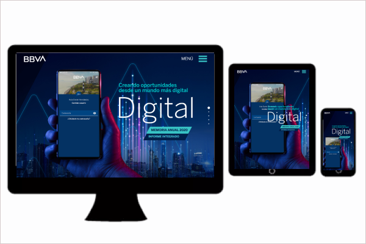

# Portafolio de Desarrollo Web
¡Hola! Soy Analista Programadora y Desarrolladora Web.

En este portafolio presento algunos de los sitios web y aplicaciones que he desarrollado durante mi experiencia profesional, utilizando diferentes tecnologías y herramientas.

## Tecnologías

- PHP
- ASP.NET MVC
- HTML5
- CSS3
- JavaScript
- WordPress
- SQL Server
- MySQL
- Páginas en Responsive Design
- Bootstrap
- Jquery

## Proyectos

### Sitio web corporativo – Minera Poderosa

**Descripción:**
Desarrollo de un sitio web corporativo responsive, orientado a presentar información institucional, noticias, eventos y contenido de la empresa.

 Mi participación
- Desarrollo y adaptación de las páginas web para distintos dispositivos.
- Implementación de secciones informativas y contenido corporativo.
- Coordinación de recursos gráficos y tamaños de imágenes para su correcta visualización.
- Supervisión de dos personas durante el desarrollo del proyecto.

**Tecnologías:** HTML, CSS, Jquery, Boostrapt, ASP.NET MVC, SQL SERVER, Responsive Design

**Tipo de proyecto:** Sitio web corporativo responsive.

**Link:** (https://www.poderosa.com.pe/)

### Sitio web corporativo – Universidad UDEP | Lima

**Descripción:**
Desarrollo de un sitio web corporativo responsive, orientado a presentar información institucional, noticias, eventos y contenido de la empresa.

 Mi participación
- Desarrollo y adaptación de las páginas web para distintos dispositivos.
- Implementación de secciones informativas y contenido corporativo.
- Coordinación de recursos gráficos y tamaños de imágenes para su correcta visualización.
- Supervisión de dos personas durante el desarrollo del proyecto.

**Tecnologías:** HTML, CSS, Jquery, Boostrapt, ASP.NET MVC, SQL SERVER, Responsive Design

**Tipo de proyecto:** Sitio web corporativo responsive.

**Link:** (https://www.udep.edu.pe/admision/lima/)

### Sitio web corporativo – Banco BBVA | Memorias Financieras

**Link:** (https://extranetperu.grupobbva.pe/memoria2016/)

**Link:** (https://extranetperu.grupobbva.pe/memoria2017/)

**Link:** (https://extranetperu.grupobbva.pe/memoria2020/)

**Link:** (https://extranetperu.grupobbva.pe/memoria2021/)

**Link:** (https://extranetperu.grupobbva.pe/memoria2022/)

**Link:** (https://extranetperu.grupobbva.pe/memoria2023/)

**Link:** (https://extranetperu.grupobbva.pe/memoria2024/)

**Descripción:**
Desarrollo de un sitio web corporativo responsive, orientado a presentar información institucional, noticias, eventos y contenido de la empresa.

 Mi participación
- Desarrollo y adaptación de las páginas web para distintos dispositivos.
- Implementación de secciones informativas y contenido corporativo.
- Coordinación de recursos gráficos y tamaños de imágenes para su correcta visualización.
- Supervisión de dos personas durante el desarrollo del proyecto.

**Tecnologías:** HTML, CSS, Jquery, Boostrapt, ASP.NET MVC, SQL SERVER, Responsive Design

**Tipo de proyecto:** Sitio web corporativo responsive.

### Sitio web corporativo – Fenix

**Descripción:**
Desarrollo de un sitio web corporativo responsive, orientado a presentar información institucional, noticias, eventos y contenido de la empresa.

 Mi participación
- Desarrollo y adaptación de las páginas web para distintos dispositivos.
- Implementación de secciones informativas y contenido corporativo.
- Coordinación de recursos gráficos y tamaños de imágenes para su correcta visualización.
- Supervisión de dos personas durante el desarrollo del proyecto.

**Tecnologías:** HTML, CSS, Jquery, Boostrapt, ASP.NET MVC, SQL SERVER, Responsive Design

**Tipo de proyecto:** Sitio web corporativo responsive.

**Link:** (https://www.fenix.com.pe/)

### Sitio web corporativo – El Museo de Arte Precolombino | MAP Cusco

**Descripción:**
Desarrollo de un sitio web corporativo responsive, orientado a presentar información institucional, noticias, eventos y contenido de la empresa.

 Mi participación
- Desarrollo y adaptación de las páginas web para distintos dispositivos.
- Implementación de secciones informativas y contenido corporativo.
- Coordinación de recursos gráficos y tamaños de imágenes para su correcta visualización.
- Supervisión de dos personas durante el desarrollo del proyecto.

**Tecnologías:** HTML, CSS, Jquery, Boostrapt, ASP.NET MVC, SQL SERVER, Responsive Design

**Tipo de proyecto:** Sitio web corporativo responsive.

**Link:** (https://mapcusco.pe/)
## Contacto
Puedes contactarme a través de mi perfil de GitHub o LinkedIn.
